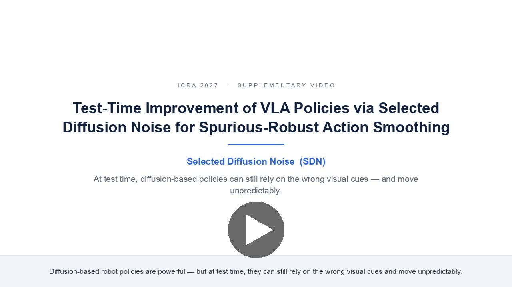
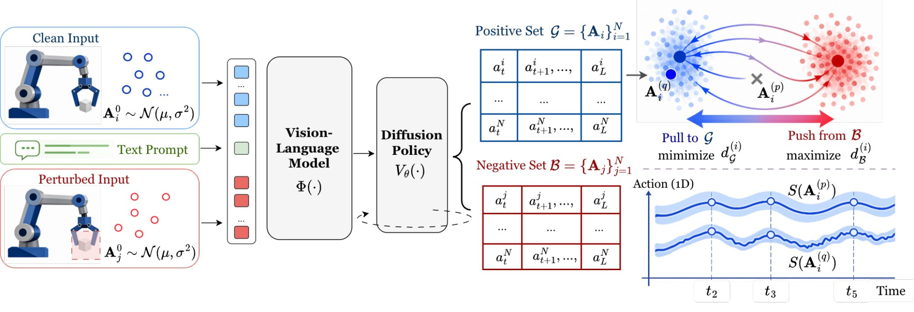

<div align="center">

# SDN: Test-Time Improvement of VLA Policies via Selected Diffusion Noise for Spurious-Robust Action Smoothing

<!-- TODO: add the arXiv badge once the paper has an id:
<a href="https://arxiv.org/abs/XXXX.XXXXX"></a>
-->
<a href="https://sdn-vla.github.io"></a>
<a href="assets/sdn_video.mp4"></a>
<a href="#citation"></a>

<a href="assets/sdn_video.mp4"></a>

</div>


Code and run scripts for **Selected Diffusion Noise (SDN)**, a training-free, test-time
action-selection method for diffusion / flow-matching VLA policies. Each initial noise of
such a policy gives a different action chunk, so at every step SDN samples several chunks
and selects one, without retraining the policy.

[](https://sdn-vla.github.io)

## Contents
- [1. Installation](#1-installation)
- [2. Checkpoints](#2-checkpoints)
- [3. Evaluation](#3-evaluation)
- [4. Using SDN with another backbone](#4-using-sdn-with-another-backbone)
- [Citation](#citation) · [License](#license) · [Acknowledgements](#acknowledgements)

## 1. Installation

```bash
git clone https://github.com/ducido/SDN.git
cd SDN
conda create -n sdn python=3.10
conda activate sdn
bash scripts/install_dependencies.sh
```

Also required: `ffmpeg` on `PATH` for the episode GIFs.

## 2. Checkpoints

```bash
huggingface-cli login
bash scripts/download_pretrained_weights.sh
```

`huggingface-cli login` is needed for the gated PaliGemma weights.

| checkpoint | path | used for |
|---|---|---|
| open-pi-zero | `pretrained/open-pi-zero` | π0\* |
| PaliGemma | `pretrained/paligemma-3b-pt-224` | π0\* |
| Grounding-DINO | `pretrained/grounding-dino-base` | object masks on SIMPLER |
| SAM 2.1 | `pretrained/sam2.1_hiera_large.pt` | object masks on SIMPLER |
| LaMa | `pretrained/big-lama` | `negative_mode inpaint`; download manually, see the script |

## 3. Evaluation

Reproduce π0\* + SDN on the 9 SIMPLER tasks of Table II (100 episodes per task, on 4 GPUs):

```bash
N_TRAJS=100 bash policy/pizero/scripts/run_sdn.sh 4
```

Each task writes `results/pizero/sdn/<options>/<task>/000_success_<rate>.log`. Success rate in %:

| | Close Drawer | Move Near | Open Drawer | Pick Coke | Apple in Drawer | Carrot on Plate | Eggplant in Basket | Spoon on Towel | Stack Cube | Avg |
|---|---|---|---|---|---|---|---|---|---|---|
| π0\* (paper) | 75.7 | 67.3 | 38.0 | 84.0 | 17.0 | 58.0 | 86.0 | 80.7 | 68.7 | 63.9 |
| π0\* + SDN | 87 | 78 | 50 | 89 | 26 | 63 | 92 | 90 | 78 | 72.6 |

The paper row is the per-task best over k ∈ {6, 10} × M ∈ {3, 5} with N = 12. The run was measured on 4 NVIDIA H100 GPUs; on another GPU or driver a task can differ by several points.

## 4. Using SDN with another backbone

`sdn/selection.py` depends only on PyTorch. Given candidate chunks from the original
observation, `actions` with shape `[N, T, D]`, and from the negative observation,
`neg_actions` with shape `[C, T, D]`:

```python
from sdn.selection import sdn_select

idx = sdn_select(actions, neg_actions, knn_k=6, top_m=3, grounding_horizon=exec_horizon)
chunk_to_execute = actions[idx, :exec_horizon]
```

## Citation

```bibtex
@article{nguyen2026sdn,
  title  = {Test-Time Improvement of VLA Policies via Selected Diffusion Noise
            for Spurious-Robust Action Smoothing},
  author = {Nguyen, Duc Minh and Dao, Bao-Ngoc and Luu, Tung M. and Nguyen, Binh Gia and
            Tong, Vinh and Liu, Anji and Duong, Vu N. and Le, Dung D. and Sonntag, Daniel and
            Le, Trung and Le, Ngan and Peters, Jan and Le, An Thai and Vu, Minh Nhat and
            Niepert, Mathias and Doan, Khoa D. and Nguyen, Duy M. H. and Ngo, Vien Anh},
  year   = {2026}
}
```

## License

## Acknowledgements

We thank the authors of [open-pi-zero](https://github.com/allenzren/open-pi-zero), [SimplerEnv](https://github.com/simpler-env/SimplerEnv), [ManiSkill2_real2sim](https://github.com/simpler-env/ManiSkill2_real2sim), [Grounded-SAM-2](https://github.com/IDEA-Research/Grounded-SAM-2), [Inpaint-Anything](https://github.com/geekyutao/Inpaint-Anything) and [PCD](https://github.com/Koorye/PCD) for releasing their code.
